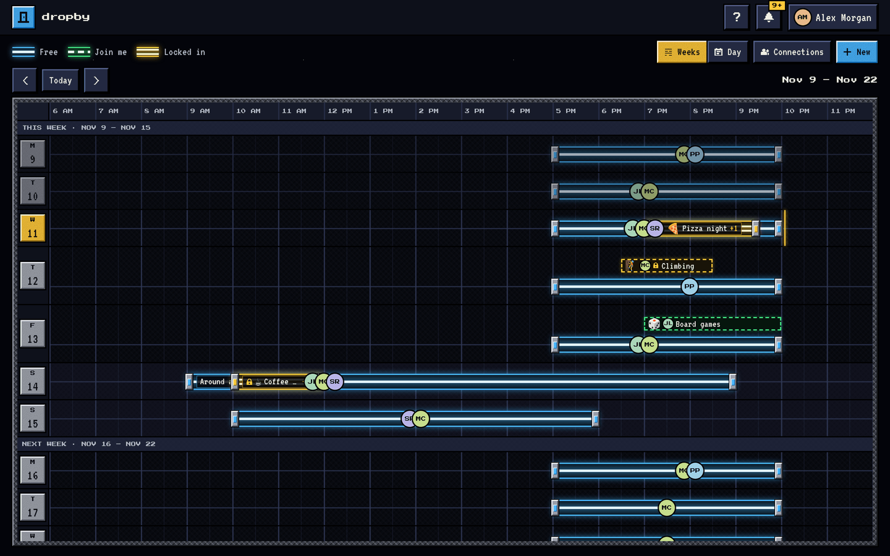
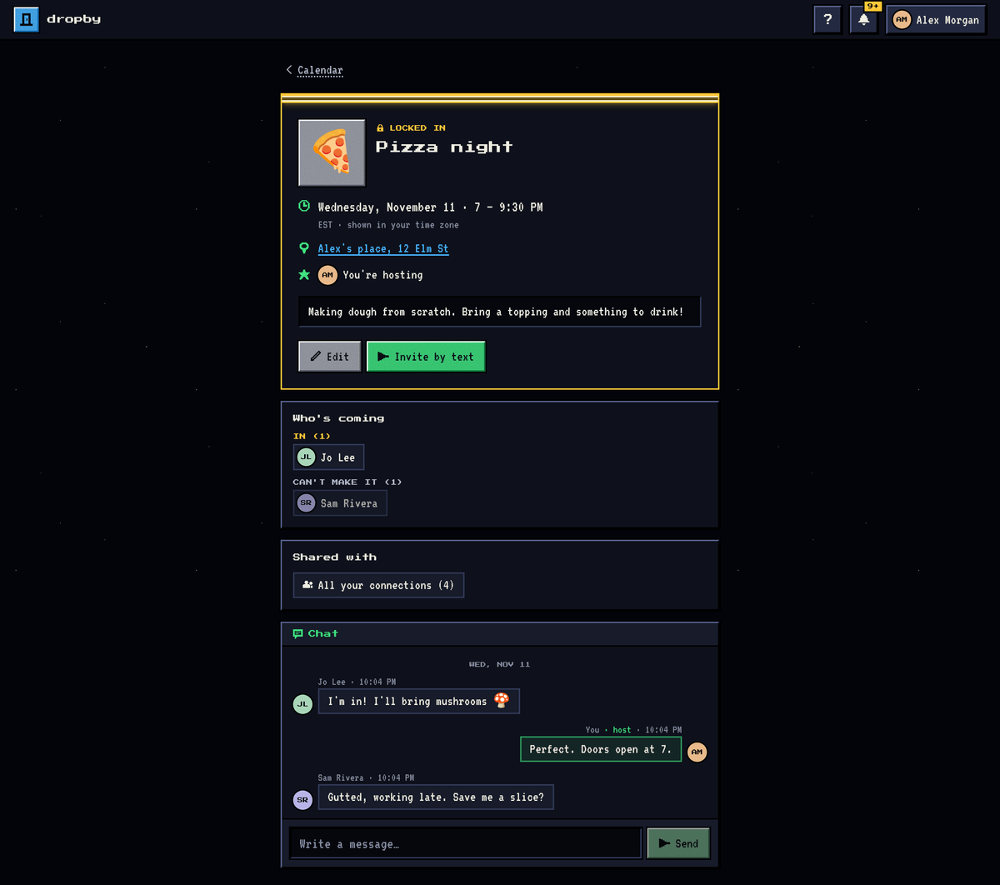
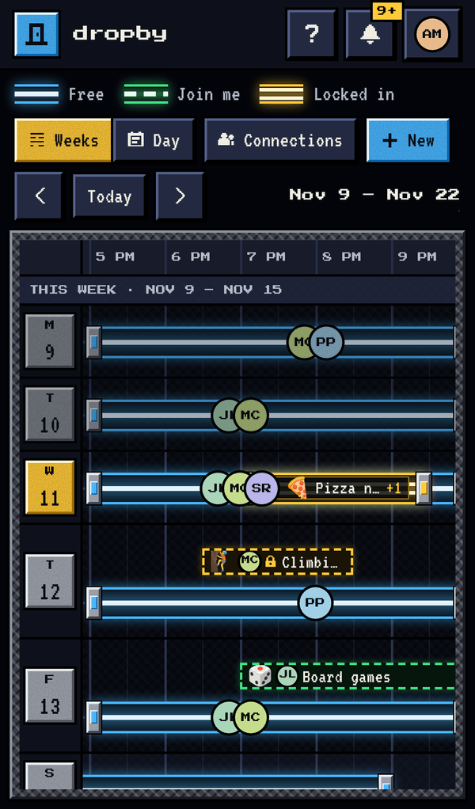

# dropby

A social availability calendar. Friends show when they're **free** and when they're **hosting**, and see each other's openings at a glance. It runs in the browser and installs to a phone's home screen like an app.

- **Blue = Free.** "I'm available." Friends see your avatar over that time on their calendar.
- **Green = Join me.** "I'm hosting." Has an emoji, a page like a party invite, RSVPs and a chat.
- **Gold = Locked in.** Someone said they're in. It's happening.

Built with Next.js (App Router), TypeScript, Tailwind, and Supabase (database, sign-in, file storage, live updates). Hosted on Vercel.



| A hosted event | On a phone |
| --- | --- |
|  |  |

---

## Contents

1. [Going live, step by step](#going-live-step-by-step) (written for someone who is not a developer)
2. [Demo data](#demo-data)
3. [Running it on your own computer](#running-it-on-your-own-computer)
4. [Tests](#tests)
5. [How it works](#how-it-works)
6. [Where things are in the code](#where-things-are-in-the-code)
7. [Changing things](#changing-things)
8. [Troubleshooting](#troubleshooting)

---

## Going live, step by step

You need three free accounts: **Supabase** (the database), **Vercel** (the hosting) and, when you want real text messages, **Twilio**. Do them in this order. Steps 1 and 2 get you a working site with a test sign-in code; step 4 switches on real texts.

> Menu names in these dashboards change now and then. If a name below doesn't match exactly, look for the closest one.

### Step 1: Supabase (about 15 minutes)

1. Go to [supabase.com](https://supabase.com), sign up, and click **New project**. Pick any name (for example `dropby`), set a database password (save it somewhere), and choose a region near your users. Wait for it to finish setting up.
2. **Create the database tables.** In the left menu open **SQL Editor**. For each file in this repository's [`supabase/migrations`](supabase/migrations) folder, **in order of the number at the start of its name** (`20261111000100_schema.sql` first):
   - open the file on GitHub, click **Raw**, select all and copy;
   - paste into a new query in the SQL Editor and click **Run**;
   - wait for "Success" before doing the next file.

   (Developers can instead run `npx supabase link` then `npm run db:push`.)
3. **Copy three values** for step 2. Open **Project Settings → API Keys** (the URL is also shown on the project's home page and under **Project Settings → Data API**):
   - **Project URL**, like `https://abcdefgh.supabase.co`. It ends at `.co`. Some pages show a longer version ending in `/rest/v1/`; either works, the app trims it.
   - **Publishable key**, starts with `sb_publishable_` (older projects: the `anon` key)
   - **Secret key**, starts with `sb_secret_` (older projects: the `service_role` key). Treat this like a password.
4. **Leave these settings at their defaults:**
   - **Authentication → Sign In / Providers → Email**: keep it **enabled**. dropby never sends email, but the test sign-in in step 3 relies on it internally.
   - **Authentication → Sessions**: leave "time-box" and "inactivity timeout" **off**, so people stay signed in.

### Step 2: Vercel (about 10 minutes)

1. Go to [vercel.com](https://vercel.com), sign up with your GitHub account, click **Add New → Project**, and import the `ahdean/dropby` repository. Vercel detects Next.js by itself; don't change the build settings.
2. Before clicking Deploy, open **Environment Variables** and add these five:

   | Name | Value |
   | --- | --- |
   | `NEXT_PUBLIC_SUPABASE_URL` | the Project URL from step 1 |
   | `NEXT_PUBLIC_SUPABASE_PUBLISHABLE_KEY` | the Publishable key |
   | `SUPABASE_SECRET_KEY` | the Secret key |
   | `DEV_LOGIN_ENABLED` | `true` |
   | `DEV_LOGIN_CODE` | six digits of your choosing, e.g. `482913` |

3. Click **Deploy**. After a minute or two you get an address like `https://dropby-xxxx.vercel.app`.
4. Add one more environment variable, **`NEXT_PUBLIC_SITE_URL`**, set to that address (no slash at the end), then **Deployments → ⋯ → Redeploy**. Invite links use this address.
5. Back in Supabase, open **Authentication → URL Configuration** and set **Site URL** to the same address.

From now on, every change pushed to the `main` branch on GitHub is deployed automatically.

### Step 3: Try it (dev login)

Open your site. Enter any US mobile number, press **Text me a code**, and type your `DEV_LOGIN_CODE`. No text is sent, and the code is never shown on screen: only people you give it to can use it. You're in.

> **Dev login is a master key.** While `DEV_LOGIN_ENABLED` is `true`, anyone who knows (or guesses) the code can sign in as any phone number. Use it only for trying things out, don't put real private plans in, and switch it off in step 4.

> **Changing a setting in Vercel does nothing until you redeploy** (Deployments → ⋯ → Redeploy). This catches everyone once.

If something doesn't work, open `/setup/check` on your site: it lists what is configured and what isn't.

To fill the app with demo people and plans, see [Demo data](#demo-data).

### Step 4: Twilio, for real text messages

The simplest route is **Twilio Verify**: Twilio handles the sender numbers and US carrier registration for you.

1. Sign up at [twilio.com](https://www.twilio.com) and **upgrade the account** (add a payment method). A trial account can only text numbers you've verified by hand.
2. In the Twilio Console open **Verify → Services → Create new**. Name it `dropby`, enable the **SMS** channel, and create it. Copy the **Service SID** (starts with `VA`).
3. From the Twilio Console home page copy your **Account SID** (starts with `AC`) and **Auth Token**.
4. In Supabase open **Authentication → Sign In / Providers → Phone**:
   - turn **Enable Phone provider** on;
   - **SMS provider**: `Twilio Verify`;
   - paste the Account SID, Auth Token, and Verify Service SID;
   - keep **Enable phone confirmations** on;
   - Save.
5. In Vercel set `DEV_LOGIN_ENABLED` to `false` and redeploy. (While dev login is on, no texts are sent at all, so this is what switches real texts on.)
6. On your site, sign in with your real number. If the code arrives and works, you're live.
7. If it doesn't, set `DEV_LOGIN_ENABLED` back to `true` and redeploy while you sort it out (see [Troubleshooting](#troubleshooting)).

Good to know:

- **Cost.** Twilio charges a few cents per verification. Set a spending alert in Twilio.
- **Abuse.** Bots sometimes hammer "send me a code" forms to run up SMS bills. Twilio Verify's Fraud Guard is on by default, and Supabase limits how often codes can be requested (**Authentication → Rate Limits**). Adding a CAPTCHA to the sign-in form is a sensible next step; it is not built yet.
- **Using a plain Twilio phone number instead of Verify** also works (choose `Twilio` as the provider and supply a Messaging Service SID), but US carriers then require "A2P 10DLC" registration, which takes days to weeks.
- **People who signed up with dev login keep their accounts.** They are ordinary phone accounts; the same number with a texted code signs into the same account.

### Step 5 (later): your own domain

In Vercel open **Settings → Domains** and add the domain. Then update `NEXT_PUBLIC_SITE_URL` in Vercel and the **Site URL** in Supabase to the new address, and redeploy.

---

## Updating the database

Most updates to dropby only change the app, and Vercel deploys them by itself. Now and then a new feature needs a change to the database too. When that happens a new file appears in [`supabase/migrations`](supabase/migrations), and it has to be run once:

1. Open the new file on GitHub, click **Raw**, select all and copy.
2. In Supabase open **SQL Editor**, paste into a new query and click **Run**.

Files are numbered by date; run any you haven't run yet, oldest first. Running a file twice fails harmlessly with "already exists". Until a new file is run, the feature that needs it says so on screen and the rest of the app keeps working.

| File | Adds |
| --- | --- |
| `20261111000100` … `000500` | Everything the first version needs (step 1.2 above) |
| `20261114000100_direct_messages.sql` | Private messages between two people |

(Developers: `npm run db:push` applies whatever is pending.)

---

## Demo data

The seed script creates seven demo people with connections, two groups, and a couple of weeks of blocks, including a hosted event with RSVPs and chat.

It runs from a computer with [Node.js](https://nodejs.org) 20 or newer:

```bash
git clone https://github.com/ahdean/dropby.git
```

```bash
cd dropby
```

```bash
npm install
```

Create a file called `.env.local` (copy `.env.example`) containing your `NEXT_PUBLIC_SUPABASE_URL` and `SUPABASE_SECRET_KEY`, then:

```bash
npm run seed
```

To also connect **your own** account to the demo friends, so they show up on your calendar:

```bash
npm run seed -- --me 2025551234
```

To remove the demo people and everything they own:

```bash
npm run seed -- --clear
```

While dev login is on you can sign in as any demo person with the dev code:

| Person | Phone | In the demo |
| --- | --- | --- |
| Alex Morgan | (202) 555-0100 | The main character: hosts Pizza night, free most evenings |
| Mika Chen | (202) 555-0101 | Hosts weekly Climbing, owns the "Climbing crew" group |
| Jo Lee | (202) 555-0102 | Hosts Board games |
| Sam Rivera | (202) 555-0103 | Free at weekends |
| Priya Patel | (202) 555-0104 | Hosts Pancake brunch next week |
| Devon Brooks | (202) 555-0105 | A **mutual** of Alex (same group, not connected) |
| Riley Kim | (202) 555-0106 | A stranger to Alex: Alex must not see their blocks |

These `555-01xx` numbers are reserved for fiction and can't belong to a real person.

---

## Running it on your own computer

For developers. Needs Node.js 20+ and Docker (for the local Supabase stack).

```bash
npm install
```

```bash
npm run db:start
```

`db:start` prints a local URL and keys. Put them in `.env.local`:

```
NEXT_PUBLIC_SUPABASE_URL=http://127.0.0.1:54321
NEXT_PUBLIC_SUPABASE_PUBLISHABLE_KEY=<publishable key printed by db:start>
SUPABASE_SECRET_KEY=<secret key printed by db:start>
DEV_LOGIN_ENABLED=true
DEV_LOGIN_CODE=000000
NEXT_PUBLIC_SITE_URL=http://localhost:3000
```

```bash
npm run seed
```

```bash
npm run dev
```

Open http://localhost:3000 and sign in as Alex: `(202) 555-0100`, code `000000`.

| Command | What it does |
| --- | --- |
| `npm run dev` | Start the app with live reload |
| `npm run build` / `npm start` | Production build / serve it |
| `npm test` | Run all tests |
| `npm run lint` / `npm run typecheck` | Code checks |
| `npm run seed` | Demo data (see above) |
| `npm run db:start` / `db:stop` | Start / stop local Supabase |
| `npm run db:reset` | Wipe the local database and re-apply the migrations |
| `npm run db:push` | Apply new migrations to the linked hosted project |

Locally, `(202) 555-0100` also accepts the real "texted code" path with the code `123456` (configured in `supabase/config.toml`), which is handy for testing with dev login switched off.

---

## Tests

```bash
npm test
```

No setup needed: the database tests start a real Postgres in memory (PGlite), apply the actual migration files, and run every check as a specific signed-in user, so row-level security is exercised for real.

| File | Covers |
| --- | --- |
| `tests/db/visibility.test.ts` | Sharing and visibility: who can read a block, its RSVPs, chat and share lists; signed-out visitors; profiles; avatar storage |
| `tests/db/connections.test.ts` | Connections, mutuals, groups, blocking |
| `tests/db/events.test.ts` | RSVPs, chat, notifications, invite links |
| `tests/db/messages.test.ts` | Private messages: who can write to whom, privacy, quotes |
| `tests/unit/time.test.ts` | UTC ↔ local time, daylight saving, splitting by day, formatting |
| `tests/unit/recurrence.test.ts` | Weekly repeats across daylight-saving changes and time zones |
| `tests/unit/intervals.test.ts` | Block overlap, snapping, dragging, resizing, stacking |
| `tests/unit/model.test.ts` | Turning rows into what the calendar draws; the gold "locked in" rule |
| `tests/unit/helpers.test.ts` | Phone numbers, invite text, default avatars |

When you change a rule in `supabase/migrations`, add or update a test in `tests/db` in the same change.

---

## How it works

### People

- **Connection**: two people where one has shared something with the other. Connections are created by the database, never directly by the app: when you share a block with a person or a group, when someone signs in from your invite link, or when a mutual presses **Connect**.
- **Mutual**: two people in the same group who aren't connected. They see each other's name and picture only, with a **Connect** button.
- **Group**: a named set of people. The owner adds people (from their connections). Any member can share a block with the group in one tap.
- **Remove** ends a connection and withdraws what the two shared directly. **Block** hides everything in both directions and isn't announced to the other person.

### Blocks and who can see them

Every block has an audience:

- **All connections** (the default): everyone you're connected to, now and later; or
- **Picked people**: a ✓/✗ per person; and
- any **groups** you add on top.

One database function, `private.can_view_block`, decides whether a person may read a block, and every policy that protects blocks, RSVPs, chat messages and share lists goes through it. This is enforced by Postgres row-level security, not by the app: a block that wasn't shared with you never leaves the database.

### Time

- Everything is stored in UTC and shown in the viewer's own time zone. The globe button on the calendar (or the profile page) lets someone pick a different zone; the choice is remembered on that device.
- A weekly repeat is one row. Each occurrence is computed in the time zone the block was created in, so "Tuesdays at 6 PM" stays at 6 PM when the clocks change.
- The week view fits the whole day across the screen (no sideways scrolling) and scrolls endlessly up and down, about a year back and two years ahead. Dragging across a day, or tapping it, adds Free time on the spot.
- The calendar shows 6 AM to 11:59 PM. A friend's block in another time zone that falls outside those hours for you is simply not shown.

### Sign-in

Phone number plus a texted one-time code (Supabase Auth). The session is kept in a long-lived cookie that is renewed on every visit, so people stay signed in. If it ever expires, the same number and a new code restore everything. A password can be added on the profile page as a second way in.

### Invites

Inviting someone who isn't on dropby creates an unguessable link and a ready-written text, and hands it to the phone's own messaging app. dropby's servers never send texts on a user's behalf. The link shows a small public preview (no address, no guest list); signing up from it connects the newcomer to the sharer. Links last 30 days and can be switched off.

### Private messages

One private conversation per pair of connections, reachable from the chat-bubble in the header, from a friend's block ("Message"), from an event page and from Connections. Opening it from a block attaches that block as a quote to the next message, so the other person knows what it is about. The quote is written by the database from the real block; only the two people can read the conversation.

### Live updates

The browser subscribes to row changes through Supabase Realtime, which applies the same row-level security per subscriber. On any change, the affected data is refetched.

---

## Where things are in the code

```
supabase/migrations/     The database: tables, security rules, triggers. START HERE for any rule change.
  …100_schema.sql          tables
  …200_functions.sql       the visibility rule, connection logic, notification triggers
  …300_policies.sql        row-level security and grants
  …400_rpc.sql             functions the app calls (connect, mutuals, invites)
  …500_storage_realtime.sql  avatars bucket, realtime
  2026111400…_direct_messages.sql  private messages (added later; see "Updating the database")

src/lib/                 Logic with no screens in it (all unit-tested)
  constants.ts             product settings: hours shown, snap, weeks ahead …
  time.ts                  time zones, formatting
  recurrence.ts            weekly repeats
  calendar/intervals.ts    overlap, snapping, drag maths, stacking
  calendar/model.ts        rows → what the calendar draws
  data/                    reading and writing Supabase (one file per area)
  supabase/                Supabase clients (browser, server, admin) and the request proxy
  auth/dev-login.ts        the test sign-in

src/components/
  calendar/                week grid, day view, editor, quick look, sharing picker, invite dialog, drag gestures
  messages/                private conversations and the inbox
  event/                   event page and chat
  connections/, profile/   those pages
  shell/                   header, notifications, help, first-run welcome
  ui/                      buttons, dialogs, avatars, pixel icons

src/app/                 Pages (thin: they mostly render one component)
  (app)/                   signed-in pages: calendar, e/[id], connections, profile
  login/                   sign-in page and its server actions
  i/[token]/               public invite preview
  globals.css              the theme: colours, tiles, beams

scripts/seed.ts          demo data
tests/                   see "Tests"
public/sw.js             service worker (installable app); public/offline.html is its offline screen
```

`AGENTS.md` is a note that Next.js adds for AI coding tools; it can be ignored.

---

## Changing things

- **Hours shown, snap interval, how far ahead the calendar goes, invite lifetime:** `src/lib/constants.ts`.
- **Colours and the retro look:** the tokens at the top of `src/app/globals.css`. Blue/green/gold are defined once and used everywhere.
- **Event icons** (the favourites row and the longer list in the editor): `src/lib/event-icon.ts`. The default is dropby's own green open door.
- **Interface icons:** each is a 12×12 bitmap in `src/components/ui/PixelIcon.tsx`. App icons and the favicon: `node scripts/make-icons.mjs`.
- **A database rule:** add a **new** file in `supabase/migrations` (never edit one that has already been applied to the live database), add a test in `tests/db`, then apply it (SQL Editor, or `npm run db:push`).
- **More countries for phone numbers:** `src/lib/phone.ts` and the `+1` shown on the sign-in form.

---

## Troubleshooting

**First stop: open `/setup/check` on your site** (for example `https://your-site.vercel.app/setup/check`). It tests every setting and says in plain words what is done, what is still to do, and what is broken. It shows no keys or codes, and it is only available while test sign-in is on.

| What you see | Likely cause and fix |
| --- | --- |
| "Almost there" setup page | The Supabase environment variables are missing in Vercel. Add them and redeploy. |
| "The Supabase address looks wrong" or "Could not reach Supabase" | `NEXT_PUBLIC_SUPABASE_URL` in Vercel isn't your project's address. It should look like `https://abcdefgh.supabase.co`. Fix it and redeploy. |
| "Supabase refused the key" or "SUPABASE_SECRET_KEY is missing" | `SUPABASE_SECRET_KEY` in Vercel must be the **secret** key (`sb_secret_…`), not the publishable one. Fix it and redeploy. |
| "The database tables are not set up yet" or "database error while creating the account" | The five database files haven't all been run, or not in order (step 1.2). |
| "Couldn't load your profile" after signing in | Same as above if the site is brand new; otherwise a connection problem. Sign out and in again after fixing. |
| Any other "Dev login failed: …" | The rest of the message is Supabase's own wording. Check that the Email provider is still enabled in Supabase. |
| "Phone sign-in is not switched on yet" | The Phone provider isn't enabled in Supabase (step 4). Until it is, only the dev code works; password sign-in also needs it. |
| "The text message could not be sent. Site owner: …" | The rest of the message says why, for example a Twilio trial account, a Twilio compliance profile that is not approved yet, a wrong SID or token, or a blocked country. Full detail is in Supabase → Logs → Auth and in Twilio → Monitor → Logs → Errors. To get back in meanwhile, set `DEV_LOGIN_ENABLED` to `true` and redeploy. |
| The code never arrives | Twilio account still in trial, or out of credit. Check **Monitor → Logs** in Twilio and **Authentication → Logs** in Supabase. |
| Signed in but the calendar says it could not load | The migrations weren't all run, or not in order. Re-run step 1.2. |
| Changes by friends don't appear until refresh | The last migration file (`…500_storage_realtime.sql`) wasn't run. |
| Profile picture upload fails | Same: the last migration file creates the storage bucket. |
| Invite links point to the wrong address | Set `NEXT_PUBLIC_SITE_URL` in Vercel and redeploy. |
