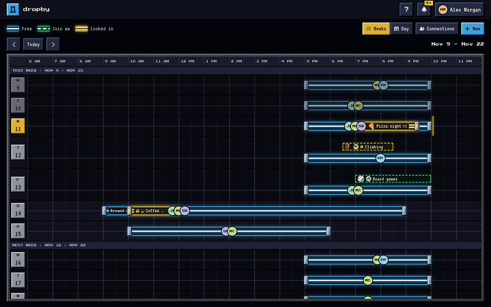
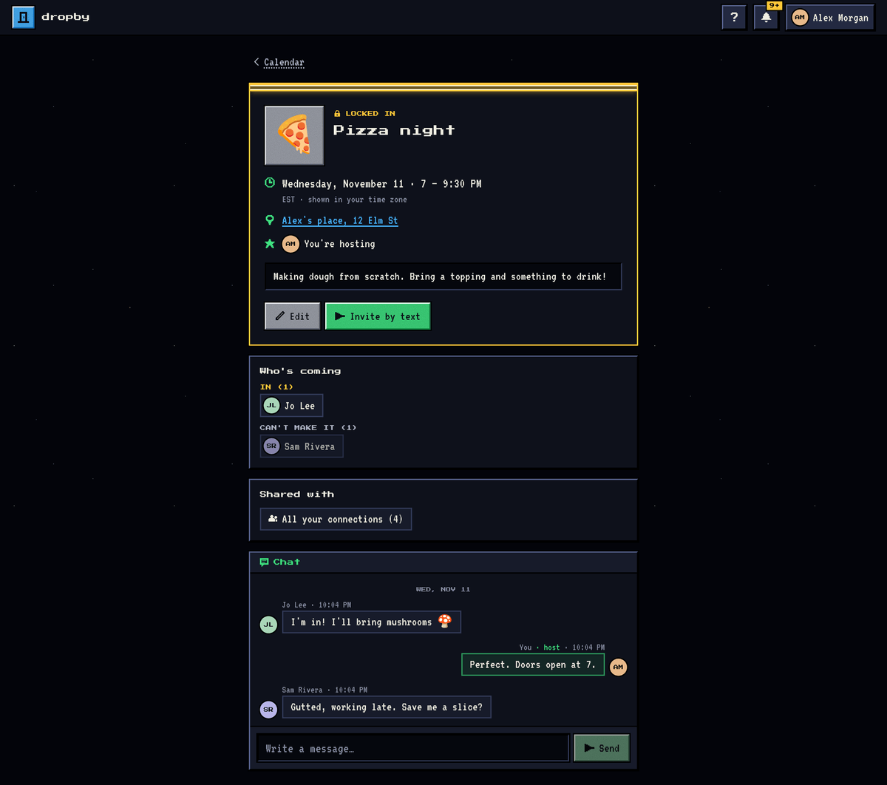
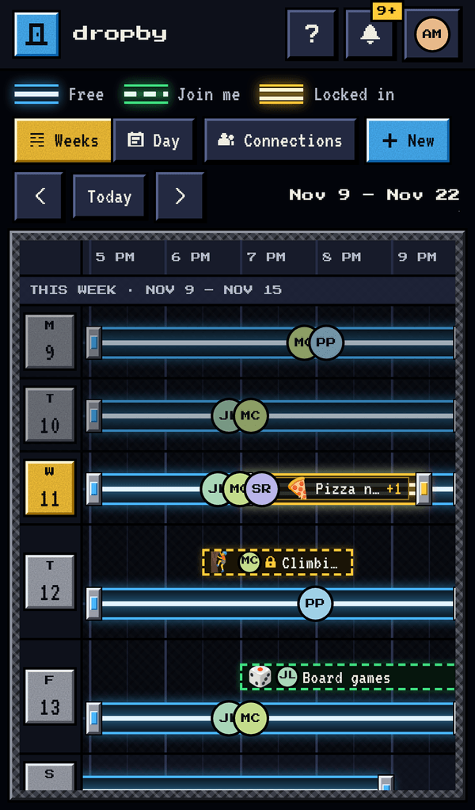

# wheet

(Formerly "dropby". The GitHub repository and the Vercel project still carry the old name; that's fine and changes nothing for users.)

A social availability calendar. Friends show when they're **free** and when they're **hosting**, and see each other's openings at a glance. It runs in the browser and installs to a phone's home screen like an app.

- **Blue = Free.** "I'm available." Friends see your face on a thin line under their own blocks over that time, and can chat about it.
- **Green = Join me.** "I'm hosting." Has an emoji, a page like a party invite, RSVPs and a chat.
- **Gold = Confirmed.** Someone said they're in. It's happening. Confirmed blocks stand out in every design: a richer gold, a thin dark-gold edge, a slow golden pulse and a glint that sweeps along now and then (only the edge with "reduce motion" on).

Built with Next.js (App Router), TypeScript, Tailwind, and Supabase (database, sign-in, file storage, live updates). Hosted on Vercel.



| A hosted event | On a phone |
| --- | --- |
|  |  |

---

## Contents

1. [Going live, step by step](#going-live-step-by-step) (written for someone who is not a developer)
2. [Demo data](#demo-data)
3. [Running it on your own computer](#running-it-on-your-own-computer)
4. [Tests](#tests)
5. [How it works](#how-it-works)
6. [Where things are in the code](#where-things-are-in-the-code)
7. [Changing things](#changing-things)
8. [Troubleshooting](#troubleshooting)

---

## Going live, step by step

You need three free accounts: **Supabase** (the database), **Vercel** (the hosting) and, when you want real text messages, **Twilio**. Do them in this order. Steps 1 and 2 get you a working site with a test sign-in code; step 4 switches on real texts.

> Menu names in these dashboards change now and then. If a name below doesn't match exactly, look for the closest one.

### Step 1: Supabase (about 15 minutes)

1. Go to [supabase.com](https://supabase.com), sign up, and click **New project**. Pick any name (for example `wheet`), set a database password (save it somewhere), and choose a region near your users. Wait for it to finish setting up.
2. **Create the database tables.** In the left menu open **SQL Editor**. For each file in this repository's [`supabase/migrations`](supabase/migrations) folder, **in order of the number at the start of its name** (`20261111000100_schema.sql` first):
   - open the file on GitHub, click **Raw**, select all and copy;
   - paste into a new query in the SQL Editor and click **Run**;
   - wait for "Success" before doing the next file.

   (Developers can instead run `npx supabase link` then `npm run db:push`.)
3. **Copy three values** for step 2. Open **Project Settings → API Keys** (the URL is also shown on the project's home page and under **Project Settings → Data API**):
   - **Project URL**, like `https://abcdefgh.supabase.co`. It ends at `.co`. Some pages show a longer version ending in `/rest/v1/`; either works, the app trims it.
   - **Publishable key**, starts with `sb_publishable_` (older projects: the `anon` key)
   - **Secret key**, starts with `sb_secret_` (older projects: the `service_role` key). Treat this like a password.
4. **Leave these settings at their defaults:**
   - **Authentication → Sign In / Providers → Email**: keep it **enabled**. wheet never sends email, but the test sign-in in step 3 relies on it internally.
   - **Authentication → Sessions**: leave "time-box" and "inactivity timeout" **off**, so people stay signed in.

### Step 2: Vercel (about 10 minutes)

1. Go to [vercel.com](https://vercel.com), sign up with your GitHub account, click **Add New → Project**, and import the `ahdean/dropby` repository. Vercel detects Next.js by itself; don't change the build settings.
2. Before clicking Deploy, open **Environment Variables** and add these five:

   | Name | Value |
   | --- | --- |
   | `NEXT_PUBLIC_SUPABASE_URL` | the Project URL from step 1 |
   | `NEXT_PUBLIC_SUPABASE_PUBLISHABLE_KEY` | the Publishable key |
   | `SUPABASE_SECRET_KEY` | the Secret key |
   | `DEV_LOGIN_ENABLED` | `true` |
   | `DEV_LOGIN_CODE` | six digits of your choosing, e.g. `482913` |

3. Click **Deploy**. After a minute or two you get an address like `https://<project>-xxxx.vercel.app`.
4. Add one more environment variable, **`NEXT_PUBLIC_SITE_URL`**, set to that address (no slash at the end), then **Deployments → ⋯ → Redeploy**. Invite links use this address.
5. Back in Supabase, open **Authentication → URL Configuration** and set **Site URL** to the same address.

From now on, every change pushed to the `main` branch on GitHub is deployed automatically.

### Step 3: Try it (dev login)

Open your site. Enter any US mobile number, press **Text me a code**, and type your `DEV_LOGIN_CODE`. No text is sent, and the code is never shown on screen: only people you give it to can use it. You're in.

> **Dev login is a master key.** While `DEV_LOGIN_ENABLED` is `true`, anyone who knows (or guesses) the code can sign in as any phone number. Use it only for trying things out, don't put real private plans in, and switch it off in step 4.

> **Changing a setting in Vercel does nothing until you redeploy** (Deployments → ⋯ → Redeploy). This catches everyone once.

If something doesn't work, open `/setup/check` on your site: it lists what is configured and what isn't.

To fill the app with demo people and plans, see [Demo data](#demo-data).

### Step 4: Twilio, for real text messages

The simplest route is **Twilio Verify**: Twilio handles the sender numbers and US carrier registration for you.

1. Sign up at [twilio.com](https://www.twilio.com) and **upgrade the account** (add a payment method). A trial account can only text numbers you've verified by hand.
2. In the Twilio Console open **Verify → Services → Create new**. Name it `wheet` (the name appears in the text people receive), enable the **SMS** channel, and create it. Copy the **Service SID** (starts with `VA`).
3. From the Twilio Console home page copy your **Account SID** (starts with `AC`) and **Auth Token**.
4. In Supabase open **Authentication → Sign In / Providers → Phone**:
   - turn **Enable Phone provider** on;
   - **SMS provider**: `Twilio Verify`;
   - paste the Account SID, Auth Token, and Verify Service SID;
   - keep **Enable phone confirmations** on;
   - Save.
5. In Vercel set `DEV_LOGIN_ENABLED` to `false` and redeploy. (While dev login is on, no texts are sent at all, so this is what switches real texts on.)
6. On your site, sign in with your real number. If the code arrives and works, you're live.
7. If it doesn't, set `DEV_LOGIN_ENABLED` back to `true` and redeploy while you sort it out (see [Troubleshooting](#troubleshooting)).

Good to know:

- **Cost.** Twilio charges a few cents per verification. Set a spending alert in Twilio.
- **Abuse.** Bots sometimes hammer "send me a code" forms to run up SMS bills. Twilio Verify's Fraud Guard is on by default, and Supabase limits how often codes can be requested (**Authentication → Rate Limits**). Adding a CAPTCHA to the sign-in form is a sensible next step; it is not built yet.
- **Using a plain Twilio phone number instead of Verify** also works (choose `Twilio` as the provider and supply a Messaging Service SID), but US carriers then require "A2P 10DLC" registration, which takes days to weeks.
- **People who signed up with dev login keep their accounts.** They are ordinary phone accounts; the same number with a texted code signs into the same account.

### Step 5 (later): your own domain (wheet.me)

Once the domain is bought (any registrar works, or buy it inside Vercel under **Domains**, which skips step 2):

1. In Vercel open your project → **Settings → Domains**, add `wheet.me`, and accept the suggestion to also add `www.wheet.me` redirecting to it.
2. Vercel then shows the DNS records to create at your registrar (usually an **A** record for `wheet.me` and a **CNAME** for `www`). Add them there and wait until Vercel shows **Valid Configuration** (minutes to a few hours).
3. In Vercel → **Settings → Environment Variables**, set `NEXT_PUBLIC_SITE_URL` to `https://wheet.me` (no slash at the end). This is the address put into invite links.
4. In Supabase → **Authentication → URL Configuration**, set **Site URL** to `https://wheet.me` and add `https://wheet.me/**` under **Redirect URLs**.
5. In Vercel → **Deployments**, open the newest one and choose **Redeploy** so the new address is built in.

The old `…vercel.app` address keeps working, so invite links already sent still open.

If you named the Twilio Verify service `dropby` in step 4, rename it to `wheet` in Twilio (**Verify → Services → your service → General settings**), since that name appears in the text people receive.

---

## Updating the database

Most updates to wheet only change the app, and Vercel deploys them by itself. Now and then a new feature needs a change to the database too. When that happens a new file appears in [`supabase/migrations`](supabase/migrations), and it has to be run once:

1. Open the new file on GitHub, click **Raw**, select all and copy.
2. In Supabase open **SQL Editor**, paste into a new query and click **Run**.

Files are numbered by date; run any you haven't run yet, oldest first. Running a file twice fails harmlessly with "already exists". Until a new file is run, the feature that needs it says so on screen and the rest of the app keeps working.

| File | Adds |
| --- | --- |
| `20261111000100` … `000500` | Everything the first version needs (step 1.2 above) |
| `20261114000100_direct_messages.sql` | Private messages between two people |
| `20261115000100_saved_places.sql` | Your own list of nicknamed places ("Home") for filling in an event's location |
| `20261126000100_pictures_and_hidden_places.sql` | Pictures on events, and crossing places out of "Used before" |
| `20261127000100_block_chats.sql` | A chat in every block (Free time too), one per week, plus private chats inside a block |
| `20261128000100_activities.sql` | Activities (with favourite spots), a type for each saved place, ideas on Free time and "I'm up for it" |

(Developers: `npm run db:push` applies whatever is pending.)

---

## Demo data

The seed script creates seven demo people with connections, two groups, and a couple of weeks of blocks, including a hosted event with RSVPs and chat.

It runs from a computer with [Node.js](https://nodejs.org) 20 or newer:

```bash
git clone https://github.com/ahdean/dropby.git
```

```bash
cd dropby
```

```bash
npm install
```

Create a file called `.env.local` (copy `.env.example`) containing your `NEXT_PUBLIC_SUPABASE_URL` and `SUPABASE_SECRET_KEY`, then:

```bash
npm run seed
```

To also connect **your own** account to the demo friends, so they show up on your calendar:

```bash
npm run seed -- --me 2025551234
```

To remove the demo people and everything they own:

```bash
npm run seed -- --clear
```

While dev login is on you can sign in as any demo person with the dev code:

| Person | Phone | In the demo |
| --- | --- | --- |
| Alex Morgan | (202) 555-0100 | The main character: hosts Pizza night, free most evenings |
| Mika Chen | (202) 555-0101 | Hosts weekly Climbing, owns the "Climbing crew" group |
| Jo Lee | (202) 555-0102 | Hosts Board games |
| Sam Rivera | (202) 555-0103 | Free at weekends |
| Priya Patel | (202) 555-0104 | Hosts Pancake brunch next week |
| Devon Brooks | (202) 555-0105 | A **mutual** of Alex (same group, not connected) |
| Riley Kim | (202) 555-0106 | A stranger to Alex: Alex must not see their blocks |

These `555-01xx` numbers are reserved for fiction and can't belong to a real person.

---

## Running it on your own computer

For developers. Needs Node.js 20+ and Docker (for the local Supabase stack).

```bash
npm install
```

```bash
npm run db:start
```

`db:start` prints a local URL and keys. Put them in `.env.local`:

```
NEXT_PUBLIC_SUPABASE_URL=http://127.0.0.1:54321
NEXT_PUBLIC_SUPABASE_PUBLISHABLE_KEY=<publishable key printed by db:start>
SUPABASE_SECRET_KEY=<secret key printed by db:start>
DEV_LOGIN_ENABLED=true
DEV_LOGIN_CODE=000000
NEXT_PUBLIC_SITE_URL=http://localhost:3000
```

```bash
npm run seed
```

```bash
npm run dev
```

Open http://localhost:3000 and sign in as Alex: `(202) 555-0100`, code `000000`.

| Command | What it does |
| --- | --- |
| `npm run dev` | Start the app with live reload |
| `npm run build` / `npm start` | Production build / serve it |
| `npm test` | Run all tests |
| `npm run lint` / `npm run typecheck` | Code checks |
| `npm run seed` | Demo data (see above) |
| `npm run db:start` / `db:stop` | Start / stop local Supabase |
| `npm run db:reset` | Wipe the local database and re-apply the migrations |
| `npm run db:push` | Apply new migrations to the linked hosted project |

Locally, `(202) 555-0100` also accepts the real "texted code" path with the code `123456` (configured in `supabase/config.toml`), which is handy for testing with dev login switched off.

---

## Tests

```bash
npm test
```

No setup needed: the database tests start a real Postgres in memory (PGlite), apply the actual migration files, and run every check as a specific signed-in user, so row-level security is exercised for real.

| File | Covers |
| --- | --- |
| `tests/db/visibility.test.ts` | Sharing and visibility: who can read a block, its RSVPs, chat and share lists; signed-out visitors; profiles; avatar storage |
| `tests/db/connections.test.ts` | Connections, mutuals, groups, blocking |
| `tests/db/events.test.ts` | RSVPs, chat, notifications, invite links |
| `tests/db/messages.test.ts` | Private messages: who can write to whom, privacy, quotes |
| `tests/db/places.test.ts` | Saved places: private to their owner |
| `tests/db/pictures.test.ts` | Event pictures (own folder only, in the invite preview) and hidden places |
| `tests/db/block-chats.test.ts` | Chats in blocks: Free time too, per week, who may write privately to whom, read receipts, the bell |
| `tests/unit/audience.test.ts` | The "Shared with" list: everyone, groups and people ticking on and off |
| `tests/unit/designs.test.ts` | The list of designs (each with its style block and scene), and the pixel art (sizes, colours, animation frames) |
| `tests/unit/time.test.ts` | UTC ↔ local time, daylight saving, splitting by day, formatting |
| `tests/unit/recurrence.test.ts` | Weekly repeats across daylight-saving changes and time zones |
| `tests/unit/intervals.test.ts` | Block overlap, snapping, dragging, resizing, stacking |
| `tests/unit/model.test.ts` | Turning rows into what the calendar draws; the gold "confirmed" rule |
| `tests/unit/helpers.test.ts` | Phone numbers, invite text, default avatars |

When you change a rule in `supabase/migrations`, add or update a test in `tests/db` in the same change.

---

## How it works

### People

- **Connection**: two people where one has shared something with the other. Connections are created by the database, never directly by the app: when you share a block with a person or a group, when someone signs in from your invite link, or when a mutual presses **Connect**.
- **Mutual**: two people in the same group who aren't connected. They see each other's name and picture only, with a **Connect** button.
- **Group**: a named set of people. The owner adds people (from their connections). Any member can share a block with the group in one tap.
- **Remove** ends a connection and withdraws what the two shared directly. **Block** hides everything in both directions and isn't announced to the other person.

### Blocks and who can see them

Every block has an audience:

- **Everyone** (the default): everyone you're connected to, now and later; or
- **Picked people**: the people ticked in the "Shared with" list.

In the editor everyone starts ticked. The **Everyone** row ticks or unticks all of them, each group row ticks or unticks its members, and people can be ticked one by one. When everyone ends up ticked the block goes back to **Everyone**, which also includes people you connect with later. (Blocks saved before this list existed may also be shared with whole groups; their members show as ticked.)

One database function, `private.can_view_block`, decides whether a person may read a block, and every policy that protects blocks, RSVPs, chat messages and share lists goes through it. This is enforced by Postgres row-level security, not by the app: a block that wasn't shared with you never leaves the database.

### Time

- Everything is stored in UTC and shown in the viewer's own time zone. The globe button on the calendar (or the profile page) lets someone pick a different zone; the choice is remembered on that device.
- A weekly repeat is one row. Each occurrence is computed in the time zone the block was created in, so "Tuesdays at 6 PM" stays at 6 PM when the clocks change.
- The week view fits the whole day across the screen (no sideways scrolling) and scrolls endlessly up and down, about a year back and two years ahead. Dragging across a day, or tapping it, adds Free time on the spot.
- The week view shows 8 AM to 11 PM (set in `src/lib/constants.ts`), so an hour stays wide enough to tap on a phone. Anything earlier or later, yours or a friend's (for example after you change time zone), gets a small tab at that end of the day's row showing its time; tapping the tab opens it, or lists them if there are several. A block that is only partly inside those hours is drawn with an arrow on the cut-off end and still opens and drags normally. The day view shows all 24 hours. The block editor accepts any time of day, including blocks that end the next day (up to 24 hours long).

### Sign-in

Phone number plus a texted one-time code (Supabase Auth). The session is kept in a long-lived cookie that is renewed on every visit, so people stay signed in. If it ever expires, the same number and a new code restore everything. A password can be added on the profile page as a second way in.

### Invites

Inviting someone who isn't on wheet creates an unguessable link and a ready-written text, and hands it to the phone's own messaging app. wheet's servers never send texts on a user's behalf. The link shows a small public preview (no address, no guest list); signing up from it connects the newcomer to the sharer. Links last 30 days and can be switched off.

### Small conveniences

- **Saved places.** Keep a private list of nicknamed places ("Home" → the full address) on the profile page or from the event editor ("Manage"). When hosting, tap one to fill in "Where"; guests see the address, never your nickname. While typing an address, places from your earlier events are suggested.
- **Google Maps for "Where".** "Where" has two parts: the box, holding the words guests see ("Joe's Pizza, 7 Carmine St"), and, if the place is pinned, a **Map pin** card under it (with **Open** to check it in Google Maps, and ✕ to remove it). To pin a place, copy it in Google Maps (tap the place, then Share, Copy link; or copy the address bar on a computer) and paste it into the box: the pin goes into the card and the place's name and street go into the box, glowing for a moment. The name comes from what was pasted (the Maps app often copies the name and address with the link), or from the link itself, or, for a short maps.app.goo.gl link, from Google (a small server step, `src/app/(app)/maps-actions.ts`). If no name can be found, the box asks for one. Without a pin, a **Maps** button next to the box looks up what you typed, or opens Google Maps to find a place. Guests tapping the location go straight to the pin. Saved places work the same way (a place saved as only a pin shows its nickname in the box when picked). On the places page (profile, or **Manage** in the editor), **Add a place** starts with three steps: **1. Find it on Google Maps**, 2. Share → Copy link, **3. Paste it here** (a button that reads what you copied; the browser may ask first). The place's name fills in both the address and the place's own name. Every saved and used-before place has a **Maps** button to see where it is. The link is stored at the end of the location text after " · " (`src/lib/maps.ts`), so no database change was needed, and no Google account or key is involved.
- **Used before.** The places from your earlier events are listed under "Used before" in the places manager (not in the editor): **+** saves one under a nickname, **✗** stops it being suggested while typing (the events themselves keep their address; Undo brings it back).
- **Event pictures.** A hosted event can have a picture (editor → "Add a picture"). It is shrunk on the phone before upload and shown in the event's window on the calendar, on the invite preview and in the link bubble when an invite is texted. The file sits in the `event-pictures` storage bucket under the host's own folder; like profile pictures, anyone holding its address can load it, and the address is only handed out with the event itself.
- **Designs.** Profile → **Design**, or the bottom of the help (**?**) window, switches the look: "Light" (the default), "Retro night", "Mara", "Bulldog", "Vintage", "Sunset", "Noir", "Flowers", "Winter", "Fall", "Summer" and "Beach". The choice is remembered on each device. Every design keeps the pixel fonts and outlined pixel style, and the meaning of the colours (blue Free, green Join me, gold Confirmed).
- **Each design's own logo and help button.** The logo in the top-left corner and the picture on the help (**?**) button change with the design: a glowing blue line mara and an old computer asking "?" (Retro night), the line-drawn mara and a speech bubble (Light), the classic mara on grass and a mara in profile (Mara), the bulldog in its collar against bricks (Bulldog), a sepia cameo and a magnifying glass (Vintage), a mara in silhouette against the setting sun (Sunset), a mara in a fedora and a fedora (Noir), a flower crown and a daisy (Flowers), a bobble hat and a snowflake (Winter), a maple leaf (Fall), dark glasses and an ice lolly (Summer), a mara swimming and a beach ball (Beach). The browser-tab icon stays the line-drawn mara in every design. All in `src/components/designs/design-icons.ts`.
- **The Bulldog design.** A bulldog's den: a pixel brick wall behind everything, dark chocolate panels, tan leather buttons and a red leather "collar" frame round the calendar, with the bright beams of Retro night. The help button becomes a pixel bulldog, and the help window (and the Design card) has a little scene: the bulldog sits by its bowl, watches a red ball roll in, barks "woof!", watches it roll away and pants happily (`src/components/bulldog`, timing in `globals.css` under `bd-`).
- **Seven more designs, each with a pixel background and a little animated landscape** in the help window and on the Design card (`src/components/designs/LandscapeScene.tsx`, props in `props.ts`, motion in `globals.css` under `ls-`):
  - **Sunset**: bands of evening sky behind everything, plum panels, coral buttons; the sun sets into the sea while a mara watches from an island.
  - **Noir**: black and white with venetian-blind shadows and rain; grey panels, steel-toned beams, red only for delete; a figure under a streetlamp in the rain, with flashes of lightning.
  - **Flowers**: a meadow of tiny flowers, petal-white panels, pink buttons, a green trellis frame; swaying flowers and butterflies.
  - **Winter**: snowflakes on pale blue, snow-white panels, icy buttons, a frosted frame; pines, a snowman and falling snow.
  - **Fall**: leaves on pumpkin tan, cream panels, orange buttons, a dark wood frame; autumn trees, a pumpkin and drifting leaves.
  - **Summer**: little suns on yellow, bright panels, coral buttons, a pool-tile frame; a shining sun, drifting clouds, sunflowers and a bee.
  - **Beach**: sand with shells and starfish, sea-blue buttons, a driftwood frame; rolling waves, a striped umbrella, a gull and a crab.
- **The Vintage design.** Old and classic: aged paper with a faded pixel diamond wallpaper, ivory panels, brass buttons, a walnut frame, and inks in navy, forest green, mustard and oxblood. Its scene is a carved cuckoo clock whose pendulum swings; every twelve seconds the little door opens and the cuckoo leans out to say "wheet!" (`src/components/vintage`, timing under `vc-`).
- **The Mara design.** Named after the mara, a small long-legged rodent from Patagonia: a grassy meadow behind everything, parchment panels and wooden buttons. The help button becomes a mara in profile, and the help window (and the Design card, when Mara is picked) opens with a little scene: a small mara walks across the grass to an alpaca and sits down beside it. Two little stories take turns at random: in one it says "wheet!", gets a fright ("!"), the alpaca shuffles up close and the startled mara scurries back to the other side; in the other the alpaca shuffles up and sits down next to the mara, they sit together for a bit (a heart pops up), and then the mara walks back. The alpaca blinks and chews along the way. Tap the scene to start it from the top; with "reduce motion" on it is a still picture.
- **Several icons.** An event can carry up to four icons; the first is the main one, which suggests the title and is the one drawn where space is tight.
- **After saving an event**, it shows the way friends see it, with an **Edit** button under the picture and details to go back to editing; ✕ closes it. Saving Free time just closes the editor, as before.
- **Hover buttons (computers).** Hovering over a friend's event drops down ✓ (I'm in), ✗ (can't make it) and a chat button, so you can answer or write without opening anything. Your own blocks get the chat button too (inside the block), and so does a friend's free time: pointing anywhere along their line (not just at their face) drops the chat button under the pointer, and it chats with whoever is free at that spot (where several friends are, it shows the list to pick from). The chat button drops down a small chat box right there on the calendar: the block's messages and a message box (with the same "To" choice for private messages), which follows the block as the calendar scrolls and closes with Esc, ✕ or a click elsewhere; **Open** opens the full window. The buttons stay while the pointer is anywhere in the strip under the block, and for a moment (0.15 seconds) after it leaves, so a slanting path to them doesn't lose them. Touch screens don't show them; a tap opens the block as usual.
- **The main icon** is a line drawing of the pixel mara's face, charcoal on off-white, in every design: header, browser tab and home screen (option 2 of the ten flat, neutral options drawn in `docs/main-icon-options.png`; in the header of ten designs, `docs/main-icon-options-on-designs.png`; from `src/components/mara/icon-options.ts` by `scripts/main-icon-options.ts`).
- **Yours on top, friends underneath.** Each day on the week calendar has your own lane at the top (your blocks, as thick beams) and friends' lanes under it: their free time as a thin line with small faces, their events as slim outlined bars (stacking into another lane only if they would overlap). So your free time never covers theirs, and you can see where they line up. Hovering one of your own blocks on a computer shows its chat button inside the block. (The single-day view already had yours on the left and friends on the right.)
- **First visit.** Right after someone new gives their name on the Welcome screen, the "How wheet works" window opens by itself (the **?** button opens it any time).
- **Mara icons for events.** The twenty pixel maras (different angles, styles and moods; see `docs/mara-icon-examples.png` and `docs/mara-icon-examples-2.png`) are at the top of **More icons** when picking an event's icons. They are stored as short codes (`:m1:` to `:m20:`), drawn as pictures, and written as 🐾 in text messages and tab titles. Three maras fit in one event (the icon field holds 16 characters). The pictures are defined in `src/components/mara/icon-set.ts`; `scripts/mara-icon-examples.ts` redraws the two sheets.
- **Maras on the calendar.** Now and then (about once a minute, in every design) a mara visits the week calendar. Usually a curious one pops its head up from behind a block, looks around, wonders "?", and ducks back down. Sometimes (at most every few minutes), when a day on screen has three or more empty hours, one walks along that stretch, stops, and suggests a block there: a dashed outline shows where, and its speech bubble says "Free 1 – 3 PM? Tap to add it". Tapping the bubble adds that Free block (with Undo); pointing at the bubble keeps the mara waiting. They wait while a block is dragged, a window or chat box is open, or the page is in the background, and never appear with "reduce motion" on (`src/components/mara/CalendarMaras.tsx`, `MaraPeek.tsx`, `MaraWalk.tsx`).
- **The invite mara.** A few seconds after the block editor opens, a mara pops up from behind the **Save & invite** button, says "Psst! Invite friends" and nods at it while the button flashes, then ducks back down (once each time the editor opens; `src/components/mara/MaraNudge.tsx`).
- **No Free time over your own events.** Adding, dragging or editing Free time so it covers one of your events is refused, with a message saying which event ("You're hosting Dinner then (7 – 9 PM). Free time can't overlap your events."). Hosting an event inside your Free time is still fine, and Free time that already holds one of your events can still be stretched or shortened; it just can't be moved onto another. As before, two Free blocks or two events can't overlap each other either.
- **Grabbing an edge.** Pressing in the empty space right beside one of your blocks grabs that block's edge instead of starting a new block; a tap there opens the block. To make a block that touches another, start further away and drag up to it.
- **A phone held sideways.** On the calendar the header and toolbar tuck away to leave the height to the calendar; a small button in the corner brings them back.

### Activities and ideas

Things to do together, and where (`src/lib/activities.ts`, screens in `src/components/activities`).

- **Activities.** Profile → **Activities** (or **Manage** next to "Activity" in the editor) holds your own list: "Brunch", "Book club", each with an icon, the kinds of place it happens in ("House or Park") and, if you like, **favourite spots** from your saved places. Each spot makes a **pair** ("Brunch · Joe's Diner"). Add your own, or tap **+** on any of the 80-odd ideas under **Add from … ideas** (Food & drink, At home, Out & about, Active, From afar). Typing a name from the idea list fills in its icon and places. Only you see the list; deleting has Undo.
- **Place types.** Saved places can have a type: House, Restaurant, Café, Bar, Park, Outdoors, Remote, Gym, Venue, Shops, or your own (**+ Other**, e.g. "Rooftop"). Your own types are offered again everywhere.
- **Hosting.** The editor's plan starts with an **Activity** row: one tap on an activity fills in the icon and title; a pair fills in the place too. With an activity as the plan, the saved places of its type come first. **More ideas** opens the whole list. (Until you have activities of your own, the row offers ideas that suit the time of day.)
- **Ideas on Free time.** Free time can carry up to six ideas of what to do: add your activities, pairs or ideas from the list in a tap, or type your own. Friends see them (a bulb by your face on their calendar) and tap **Up for it?** on the ones they'd do; you're notified ("Mika is up for Brunch"), see their faces by each idea (most-picked first), and **Make it the plan** turns the Free time into an event with that idea (icon, title, place) for you to check and save. Picks are per week of a weekly repeat, and an idea taken off takes its picks with it.
- **The Ideas browser.** **Ideas** in the calendar's toolbar opens cards to flip through (arrows, swipe or the arrow keys). First come ideas for times when friends are free in the next two weeks ("Sam and Mika are free Sun 12 – 4 PM"), each with the idea that fits that time best (your pairs and activities first, then the list; brunch in the morning, at weekends; nothing out of season); then your own activities, then the list, in an order that changes daily. Filters: All, With friends, or a kind of idea. On each card: **Invite them** / **Host it** (a new event with the plan, at that time and shared with those friends; on its own, at the next time it suits), **Add to your free time** (as an idea; or **Be free then too**, new Free time then with the idea on it), **Share** (the phone's share sheet, or copy: "Anyone up for brunch Sunday 12 – 4 PM? 🥞") and, for ideas from the list, **Save** to your activities.

### Chats in blocks

One tap on a block opens everything about it, over the calendar:

- **Your own block** (Free time or an event) opens straight in the editor. Its chat is at the bottom, under the form, with its own message box; for an event, who's in is shown there too.
- **A friend's block** opens a window with when and where, "I'm in" / "Can't make it" for events, and the chat at the bottom. A friend's free time opens the same window from the list that appears when you tap their faces.

- Comments go to **everyone** who can see the block. A weekly repeat has a separate chat for each week, like its RSVPs.
- The **To** choice next to the message box sends a message **privately** to one person instead. Private messages appear in the same list in a gold dashed box marked "to …", and only the two people can see them. You can write privately to someone taking part in the block: its host, someone it was shared with by name or through a group, or someone who answered or wrote in its chat. You can always answer someone who wrote to you first, and the host can write to anyone the block is shared with.

Links to a block (from the bell, a quoted message, or an old `/e/…` page link) open the calendar with that block open: the editor for your own (scrolled to the chat), the window for a friend's. A private-message notification sets the message box to answer that person.

### Private messages

The permanent one-to-one conversations, separate from the chats in blocks: one per pair of connections, reachable from the chat-bubble in the header and from Connections. Opening one from a block attaches that block as a quote to the next message, so the other person knows what it is about. The quote is written by the database from the real block; only the two people can read the conversation.

### Live updates

The browser subscribes to row changes through Supabase Realtime, which applies the same row-level security per subscriber. On any change, the affected data is refetched.

---

## Where things are in the code

```
supabase/migrations/     The database: tables, security rules, triggers. START HERE for any rule change.
  …100_schema.sql          tables
  …200_functions.sql       the visibility rule, connection logic, notification triggers
  …300_policies.sql        row-level security and grants
  …400_rpc.sql             functions the app calls (connect, mutuals, invites)
  …500_storage_realtime.sql  avatars bucket, realtime
  2026111400…_direct_messages.sql  private messages (added later; see "Updating the database")
  2026111500…, 2026112600…   saved places; event pictures and hidden places
  2026112800…_activities.sql activities, place types, ideas on Free time, "I'm up for it"

src/lib/                 Logic with no screens in it (all unit-tested)
  constants.ts             product settings: hours shown, snap, weeks ahead …
  time.ts                  time zones, formatting
  recurrence.ts            weekly repeats
  calendar/intervals.ts    overlap, snapping, drag maths, stacking
  calendar/model.ts        rows → what the calendar draws
  audience.ts              the "Shared with" list: everyone, groups, people
  activities.ts            place types, the idea library, ideas on Free time, suggestions
  themes.ts                the designs and how the chosen one is applied
  event-picture.ts         where event pictures are stored
  data/                    reading and writing Supabase (one file per area)
  supabase/                Supabase clients (browser, server, admin) and the request proxy
  auth/dev-login.ts        the test sign-in

src/components/
  calendar/                week grid, day view, editor, quick look, sharing picker, invite dialog, drag gestures
  messages/                private conversations and the inbox
  places/                  managing saved places
  activities/              activities manager, idea picker, ideas on Free time, the Ideas browser
  event/Chat.tsx           a block's chat (comments and private messages), shown in the editor and in calendar/EventPeek.tsx
  connections/, profile/   those pages
  shell/                   header, notifications, help, first-run welcome
  ui/                      buttons, dialogs, avatars, pixel icons
  mara/                    the Mara design's pixel art, the mara-and-alpaca scene, the mara icons and the curious peeking mara
  bulldog/                 the Bulldog design's pixel bulldog and its scene
  vintage/                 the Vintage design's cuckoo clock scene
  designs/                 the landscape scenes and props for Sunset, Noir, Flowers, Winter, Fall, Summer and Beach; the designs' own logos and help-button pictures

src/app/                 Pages (thin: they mostly render one component)
  (app)/                   signed-in pages: calendar, e/[id], connections, profile
  login/                   sign-in page and its server actions
  i/[token]/               public invite preview
  globals.css              the theme: colours, tiles, beams

scripts/seed.ts          demo data
tests/                   see "Tests"
public/sw.js             service worker (installable app); public/offline.html is its offline screen
```

`AGENTS.md` is a note that Next.js adds for AI coding tools; it can be ignored.

---

## Changing things

- **Hours shown, snap interval, how far ahead the calendar goes, invite lifetime:** `src/lib/constants.ts`.
- **Colours and the retro look:** the tokens at the top of `src/app/globals.css`. Blue/green/gold are defined once and used everywhere.
- **A new design:** add it to the list in `src/lib/themes.ts` and give it a `:root[data-theme="…"]` block of colours in `src/app/globals.css` (copy the "Light" block). The Profile page lists it automatically.
- **The mara and alpaca pixel art:** `src/components/mara/sprites.ts` (each picture is rows of letters, one per pixel). The scene's timing is in `src/app/globals.css` (search for `ms-`). After changing the mara's face, `npx tsx scripts/make-icons.ts` redraws the app icons.
- **Event icons** (the favourites row and the longer list in the editor): `src/lib/event-icon.ts`. The default is wheet's own green open door.
- **Interface icons:** each is a 12×12 bitmap in `src/components/ui/PixelIcon.tsx`. App icons and the favicon (the line-drawn mara face, from `src/components/mara/icon.ts`): `npx tsx scripts/make-icons.ts`.
- **A database rule:** add a **new** file in `supabase/migrations` (never edit one that has already been applied to the live database), add a test in `tests/db`, then apply it (SQL Editor, or `npm run db:push`).
- **More countries for phone numbers:** `src/lib/phone.ts` and the `+1` shown on the sign-in form.

---

## Troubleshooting

**First stop: open `/setup/check` on your site** (for example `https://your-site.vercel.app/setup/check`). It tests every setting and says in plain words what is done, what is still to do, and what is broken. It shows no keys or codes, and it is only available while test sign-in is on.

| What you see | Likely cause and fix |
| --- | --- |
| "Almost there" setup page | The Supabase environment variables are missing in Vercel. Add them and redeploy. |
| "The Supabase address looks wrong" or "Could not reach Supabase" | `NEXT_PUBLIC_SUPABASE_URL` in Vercel isn't your project's address. It should look like `https://abcdefgh.supabase.co`. Fix it and redeploy. |
| "Supabase refused the key" or "SUPABASE_SECRET_KEY is missing" | `SUPABASE_SECRET_KEY` in Vercel must be the **secret** key (`sb_secret_…`), not the publishable one. Fix it and redeploy. |
| "The database tables are not set up yet" or "database error while creating the account" | The five database files haven't all been run, or not in order (step 1.2). |
| "Couldn't load your profile" after signing in | Same as above if the site is brand new; otherwise a connection problem. Sign out and in again after fixing. |
| Any other "Dev login failed: …" | The rest of the message is Supabase's own wording. Check that the Email provider is still enabled in Supabase. |
| "Phone sign-in is not switched on yet" | The Phone provider isn't enabled in Supabase (step 4). Until it is, only the dev code works; password sign-in also needs it. |
| "The text message could not be sent. Site owner: …" | The rest of the message says why, for example a Twilio trial account, a Twilio compliance profile that is not approved yet, a wrong SID or token, or a blocked country. Full detail is in Supabase → Logs → Auth and in Twilio → Monitor → Logs → Errors. To get back in meanwhile, set `DEV_LOGIN_ENABLED` to `true` and redeploy. |
| The code never arrives | Twilio account still in trial, or out of credit. Check **Monitor → Logs** in Twilio and **Authentication → Logs** in Supabase. |
| Signed in but the calendar says it could not load | The migrations weren't all run, or not in order. Re-run step 1.2. |
| Changes by friends don't appear until refresh | The last migration file (`…500_storage_realtime.sql`) wasn't run. |
| Profile picture upload fails | Same: the last migration file creates the storage bucket. |
| Invite links point to the wrong address | Set `NEXT_PUBLIC_SITE_URL` in Vercel and redeploy. |
